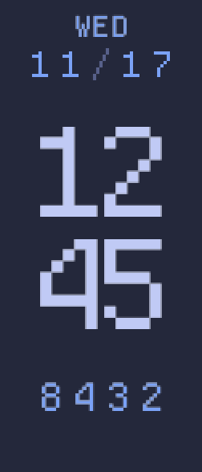
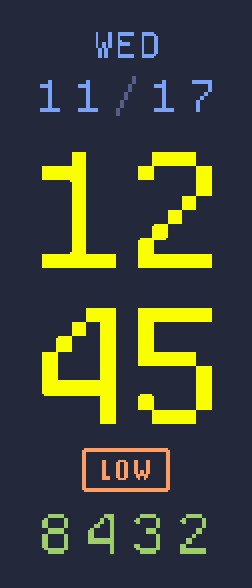
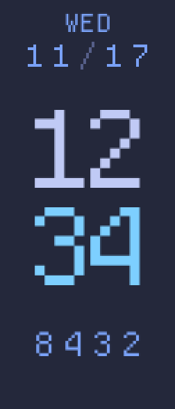
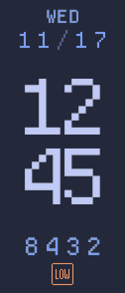
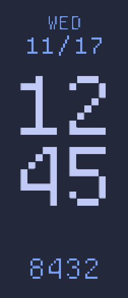

# Mi Band 5 watch faces and live designer

A collection of clean, high-contrast watch faces for the Xiaomi Mi Band 5 and a browser-based designer that builds `.bin` firmware files with pixel-exact preview.

The band has a 126x294 pixel AMOLED display. The designer renders real sprite PNGs onto an HTML5 canvas at native resolution, matching the physical watch screen.

| Tokyo Night Blue | Tokyo Night Volt | Duo Sky | Low battery warning | Custom build |
| :---: | :---: | :---: | :---: | :---: |
|  |  |  |  |  |

## Features

- Exact pixel preview. The browser studio loads real 126x294 PNG assets directly from disk. What you see on screen matches the physical hardware display.
- Balanced layout. Steps anchor the bottom curve of the display, leaving no dead void space when the battery indicator is hidden.
- Clean battery warning. The battery indicator stays hidden when battery is normal or full (20% or higher). An orange `[LOW]` badge appears between 10% and 19%, and a red `[LOW]` badge appears below 10%.
- Hardware safety enforcement. Sprite buffers are validated against the Mi Band 5 blitter limit of 4096 bytes (3056 px maximum area). All sprites use 8bpp indexed colors (`0x64`).
- Live rebuild workflow. Adjust colors, font sizes, vertical coordinates, and widget toggles in the web interface. The server generates new PNG sprites and packages the `.bin` firmware file.
- Pre-built watch faces. Includes multiple ready-to-flash colorways based on Tokyo Night palettes and retro arcade styles.

## Pre-built watch faces

The repository includes pre-compiled `.bin` files ready to install:

| File | Style | Description |
| :--- | :--- | :--- |
| `bin/clean-night-10-blue.bin` | Tokyo Night Blue | Primary blue accents with slate text |
| `bin/clean-night-11-mono.bin` | Monochrome | High contrast pure white text on deep black |
| `bin/clean-night-12-volt.bin` | Tokyo Night Volt | High-visibility yellow time digits with green steps |
| `bin/clean-night-13-aqua.bin` | Tokyo Night Aqua | Cyan time digits with subdued date indicators |
| `bin/clean-night-14-ember.bin` | Tokyo Night Ember | Warm orange and amber accents |
| `bin/clean-night-15-duo-frost.bin` | Duo Frost | White hour digits and blue minute digits |
| `bin/clean-night-16-duo-sky.bin` | Duo Sky | Ice blue hour digits and cyan minute digits |
| `bin/clean-night-17-duo-deep.bin` | Duo Deep | Navy hour digits and ice blue minute digits |
| `bin/clean-night-18-custom.bin` | Custom | Configurable build generated by the visual designer |
| `bin/retro-arcade-night.bin` | Retro Arcade | Pixel art layout with retro arcade typography |
| `bin/daily.bin` | Daily | Compact layout with high information density |
| `bin/flashlight.bin` | Utility | Solid white display utility |

To install any `.bin` file on your watch, follow the instructions in [INSTALL.md](INSTALL.md).

## Hardware and firmware guide

If you are developing custom watch faces or modifying layouts, read [HARDWARE_GUIDE.md](HARDWARE_GUIDE.md). It documents:

- The 4KB hardware blitter buffer limit and sprite dimension formulas.
- Required 8bpp indexed color format (`0x64`) and how to avoid `0x1B` crashes.
- FreeType alpha thresholding rules to prevent cut-off digits.
- Mandatory Protobuf tags (`Time.DrawingOrder: false`, `Activity.UnknownV7: 0`).
- Preview thumbnail integration for the on-device watch face carousel.

## Run the live designer

The visual designer runs locally using a Python HTTP server and a Node.js packing tool.

### Prerequisites

You need Python 3 and Node.js installed on your system.

Install Python dependencies:

```bash
pip install pillow
```

Install Node.js dependencies for the watch face packer:

```bash
npm install
```

### Start the designer server

Run the local server:

```bash
python3 server.py 8903
```

Open `http://127.0.0.1:8903/` in your browser.

When you modify colors, coordinates, or toggle display elements, the server executes `build_face.py` and packages `bin/clean-night-18-custom.bin`. You can download the compiled binary directly from the browser interface.

If you open `preview.html` directly without starting the server, you can preview face layouts and simulate values, but rebuilding `.bin` files is disabled.

## File manifest

- `bin/`: Compiled watch face `.bin` files ready to install on the band.
- `faces/`: Sprite directories containing generated PNG sprites and `watchface.json` files.
- `assets/`: Demo screenshots and preview images.
- `fonts/`: Font assets used by the layout builder.
- `scripts/`: Generator and helper scripts for watch faces.
  - `scripts/gen_max_variants.py`: Main builder for the 8 clean-night variants.
  - `scripts/generate_demos.py`: Generates pixel-exact demo screenshots in `assets/`.
  - `scripts/gen_exact.py`: Scans faces and emits `faces.js` for the browser preview canvas.
- `preview.html`: Browser designer interface and exact pixel canvas renderer.
- `server.py`: Local HTTP server providing the configuration and build endpoints.
- `build_face.py`: Sprite generator and layout builder that outputs PNGs and `watchface.json`.
- `custom-design.json`: Active design configuration file saved by the designer.
- `faces.js`: Face layout coordinates and sprite index mappings for browser preview.
- `HARDWARE_GUIDE.md`: Technical documentation of hardware blitter limits and firmware tags.
- `INSTALL.md`: Step-by-step instructions for flashing watch faces via Android and iOS.
