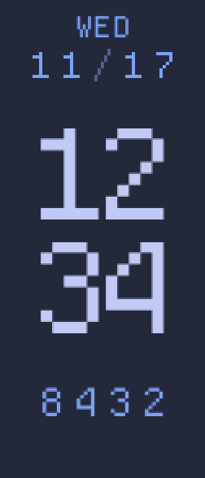
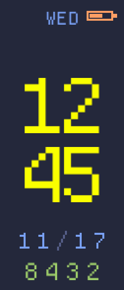
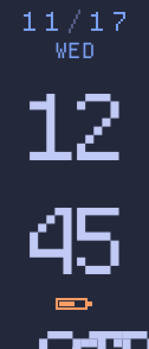
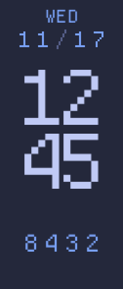

# Mi Band 5 watch faces and live designer

A collection of clean, high-contrast watch faces for the Xiaomi Mi Band 5 and a browser-based designer that builds `.bin` firmware files with exact pixel preview.

The band has a 126x294 pixel AMOLED display. The designer renders real sprite PNGs onto an HTML5 canvas at native resolution, matching the physical watch screen.

| Tokyo Night Blue | Tokyo Night Volt | Duo Sky | Low battery warning | Custom build |
| :---: | :---: | :---: | :---: | :---: |
|  |  |  |  |  |

## Features

- Exact pixel preview. The browser studio loads the real 126x294 PNG assets directly from disk. What you see on screen matches the hardware display.
- Live rebuild workflow. Adjust colors, font sizes, spacing, or element order in the web interface. The server generates new PNG sprites and repacks the `.bin` firmware file.
- Clean battery indicator. The battery icon remains completely hidden when the charge is 30% or higher. An orange indicator appears between 10% and 29%, and a red indicator appears below 10%.
- Pre-built watch faces. Includes multiple ready-to-flash colorways based on Tokyo Night palettes and retro arcade styles.
- Overflow warnings. If your element configuration exceeds the 294 pixel vertical screen limit, the designer reports the exact overflow in pixels.

## Pre-built watch faces

The repository includes pre-compiled `.bin` files ready to install:

| File | Style | Description |
| :--- | :--- | :--- |
| `clean-night-10-blue.bin` | Tokyo Night Blue | Primary blue accents with slate text |
| `clean-night-11-mono.bin` | Monochrome | High contrast pure white text on deep black |
| `clean-night-12-volt.bin` | Tokyo Night Volt | High-visibility yellow time digits with green steps |
| `clean-night-13-aqua.bin` | Tokyo Night Aqua | Cyan time digits with subdued date indicators |
| `clean-night-14-ember.bin` | Tokyo Night Ember | Warm orange and amber accents |
| `clean-night-15-duo-frost.bin` | Duo Frost | White hour digits and blue minute digits |
| `clean-night-16-duo-sky.bin` | Duo Sky | Ice blue hour digits and cyan minute digits |
| `clean-night-17-duo-deep.bin` | Duo Deep | Navy hour digits and ice blue minute digits |
| `clean-night-18-custom.bin` | Custom | Configurable build generated by the visual designer |
| `retro-arcade-night.bin` | Retro Arcade | Pixel art layout with retro arcade typography |
| `daily.bin` | Daily | Compact layout with high information density |
| `flashlight.bin` | Utility | Solid white display utility |

To install any `.bin` file on your watch, follow the instructions in [INSTALL.md](INSTALL.md).

## Run the live designer

The visual designer runs locally using a Python HTTP server and a Node.js packing tool.

### Prerequisites

You need Python 3 and Node.js installed on your system.

Install Python image dependencies:

```bash
pip install pillow
```

Install Node.js dependencies for the watch face packer:

```bash
npm install
```

### Start the designer server

Run the local server:

```bash
python3 server.py 8903
```

Open `http://127.0.0.1:8903/` in your browser.

The web interface connects to the local server over HTTP. When you modify colors, positions, or toggle display elements, the server executes `build_face.py` and packages `clean-night-18-custom.bin`. You can download the compiled binary directly from the browser interface.

If you open `preview.html` directly without starting the server, you can preview face layouts and simulate values, but rebuilding `.bin` files is disabled.

## File manifest

- `preview.html`: Browser designer interface and exact pixel canvas renderer.
- `server.py`: Local HTTP server providing the configuration and build endpoints.
- `build_face.py`: Sprite generator and layout builder that outputs PNGs and `watchface.json`.
- `custom-design.json`: Active design configuration file saved by the designer.
- `faces.js`: Face layout coordinates and sprite index mappings for browser preview.
- `INSTALL.md`: Step-by-step instructions for flashing watch faces via Android and iOS.
- `clean-night-*/`: Asset directories containing generated PNG sprites and `watchface.json` files.
